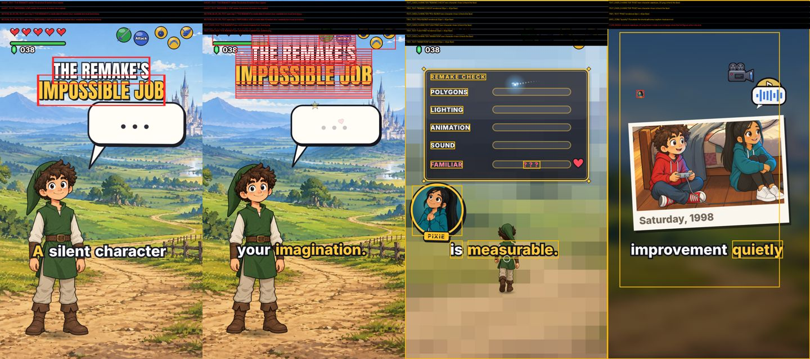

# Quality leap: what we adopted, and why it fixes what the Producer saw (2026-10-14)

Trigger: the Producer rejected the EP002 Short #2 v2 preview ("Evidentemente no estás dando tú y tus agentes la talla.
Repiten errores constantemente, la selección de algunas artes es debatible, ni se diga de los sonidos").

**Diagnosis.** Discovery was not the problem; adoption was. The 2026-10-12 scouts (`2026-10-12_SCOUT_SYNTHESIS_v2.md`,
`deep_scout_claude_skills_mcp.md`, `github_scout_skills.md`, `deep_scout_sound.md`) already named almost every craft
skill below. None was installed. Worse, two of the Producer's defects were **already described, in plain words,
by tools we had installed and never ran**:

- The title's ghost echo is the Hyperframes `motion-blur` component applied to `#title`
  (`data-hf-motion-blur='{"samplesPerFrame": 8}'`). The Hyperframes animation skill says: *"Do not blur: text meant
  to be read at that moment. A smeared word is an unreadable word."* (`hyperframes-animation/references/motion-blur.md`).
- `hyperframes lint` (shipped with our own install, 0.8.147) reports a gating error on the same Short
  (`gsap_cold_seek_hidden_fromto_missing_reveal` on `#tvLine`: a cold render worker can encode it invisible), and
  `hyperframes check` has a whole layout/contrast/caption-zone auditor. Neither was in our process.

So this pass does three things: (1) vendors the craft skills as files agents load, (2) builds the missing automated
critic for our own defect classes and proves it on Short #2 v2, (3) writes the rubric + an independent-critic step
into the method so it cannot be skipped.

## Proof: the new critic on the rejected Short #2 v2

`python3 scripts/frame_critic.py tools/hyperframes_ep002_short2/short --step 0.5 --lint` (100 samples, 90 s on CPU):
**14 errors, 41 warnings**, including exactly what the Producer saw, with timestamps:

| Producer's complaint | Critic finding |
|---|---|
| Title stacked with ghost copies, looks like a bug (0-2.5 s) | `GHOST_TEXT` "THE REMAKE'S" / "IMPOSSIBLE JOB" visible 10x at once (9 motion-blur copies) 0.1-0.3 s and 2.5-2.7 s; `MOTION_BLUR_ON_TEXT` 0.1-2.7 s |
| Title overlapping the game HUD | `TEXT_OVER_HUD` over `hud_hearts.png` and `hud_buttons.png` at 2.6-2.7 s (exit move flies through the HUD) |
| Pixie only as a tiny circular badge | `CHAR_BADGE` pix_05 at 36 s; `TINY_TEXT` "PIXIE" tag 12-20 px; `TEXT_OVER_CHARACTER` |
| Debatable, busy layout | `CLUTTER` 5 text blocks 9-17.5 s; meter labels 28-33 px (< 42 px floor on 1920); end card "FULL EPISODE" overlapping "ON THE CHANNEL" 48-49.5 s; captions outside the Shorts safe area 27.5 s, 35.5-37 s |
| Cold-render risk nobody saw | `LINT: gsap_cold_seek_hidden_fromto_missing_reveal` on `#tvLine` |

`python3 scripts/sfx_audit.py tools/hyperframes_ep002_short2/short/assets/sfx_cues.txt --mix .../narration.wav`:
**66 onsets in 49.6 s = 80/min against a budget of 18/min (at most 14 cues for this Short)**, bursts of up to
7 onsets inside 2 s (2.5, 5.1-7.4, 16.4, 25-26 s), only 28 % of the runtime free of SFX, whoosh/impact/magic families
7x each, 11 thin high-frequency cues (centroid > 5 kHz: UI clicks, reversed swells, 8-bit impacts), several
sound-alike pairs. Loudness was fine (-14.1 LUFS, -4.7 dBTP): the problem was taste and density, which the old
"no file twice" picker could not see.

## Ranked picks (what each fixes)

Licences verified this session from the repo's LICENSE file (raw.githubusercontent.com) unless noted.

| # | Pick | Licence | Fixes | Status |
|---|---|---|---|---|
| 1 | **`scripts/frame_critic.py` + `scripts/qa/dom_sampler.cjs`** (ours): seeks the composition with the real Hyperframes runtime, reads DOM boxes, flags ghost text, motion blur on text, text over text / HUD / characters, portrait badges, safe zone, tiny text, small characters, clutter; annotated frames + sheet; exit 1 on errors | ours | ghost title, HUD overlap, Pixie badge, clutter, safe zones | **INSTALLED, proven on Short #2 v2** |
| 2 | **`hyperframes lint` / `hyperframes check`** (already in `tools/hyperframes_ep003/node_modules`, heygen-com/hyperframes) | Apache-2.0 | cold-seek invisibility, overlapping tweens, layout overflow/overlap/occlusion, WCAG contrast, caption zone, motion sidecars (`*.motion.json`: appearsBy, staysInFrame, keepsMoving) | **ADOPTED** (now a required gate; nothing to install) |
| 3 | **`docs/style/DESIGN_RUBRIC.md`** + **`frame-critic` skill** (independent critic agent, generator-critic split) | ours | "repiten errores": a fixed sheet scored by an agent that did not build the piece, last-rejection checklist | **INSTALLED** |
| 4 | **`scripts/sfx_audit.py`** (ours): density budget, bursts, rest share, family fatigue, harsh cues (spectral centroid), sound-alike pairs (log-band fingerprint), over-voice cues, loudness, unmotivated cues | ours | "ni se diga de los sonidos" | **INSTALLED, proven on Short #2 v2** |
| 5 | **heygen-com/hyperframes skills** `hyperframes-creative` (house-style, video-composition, typography, beat-direction, storyboard-recipe, design-adherence, + `review-loop.md`, captions authoring/motion) and `hyperframes-animation` (SKILL, rules/, transitions/, motion-blur reference) | Apache-2.0 | art choice and layout taste for our exact engine; storyboard + review loop; "never blur text" | **VENDORED** (text subset) |
| 6 | **iart-ai/motion-design-skills**: `shot-composition`, `animation-principles` (12 principles, easing), `motion-art-direction` (restraint, motion language), `beat-sync-editing` | MIT | one focal point, hierarchy, 9:16 restack and safe areas, restraint, cut rhythm | **VENDORED** |
| 7 | **lottiefiles/motion-design-skill** `motion-design` (director/, patterns/, reference/quality-checklist.md, timing tables, troubleshooting) | MIT | the 1/3 rules, entrance/exit rules, quality checklist with severity tiers | **VENDORED** |
| 8 | **iart-ai/kinetic-typography-skills** `kinetic-typography` | MIT | titles and captions that land sharp and readable | **VENDORED** |
| 9 | **iart-ai/explainer-video-skills** `explainer-video` | MIT | script-to-screen scene grammar (Remotion commands ignored) | **VENDORED** |
| 10 | **greensock/gsap-skills** `gsap-core`, `gsap-timeline`, `gsap-performance` | MIT (GSAP itself: own no-charge licence) | correct easing/timelines; fewer seek bugs | **VENDORED** |
| 11 | **obra/superpowers** `verification-before-completion` | MIT | "evidence before claims": no "fixed" without rerunning the gates | **VENDORED** |
| 12 | microsoft/CLAP (`msclap`) and LAION-AI/CLAP (code CC0; HF weights `laion/clap-htsat-unfused` and `larger_clap_general` Apache-2.0) | MIT / CC0 / Apache-2.0 | semantic match "cue description -> SFX file" and "does this sound fit the beat" by text-audio similarity, without listening | **NOT INSTALLED**: needs PyTorch (absent) + ~600 MB weights; disk has ~2 GB. Next step when disk allows: tag `CATALOG.json` once offline, store embeddings (KBs), ship the picker a `--describe "soft cloth rustle"` query |
| 13 | qiuqiangkong/panns_inference (AudioSet tagger) | MIT text in LICENSE.MIT (copyright line is boilerplate from another project: flag) | auto-tagging the SFX catalog (527 AudioSet classes) | NOT INSTALLED (PyTorch + 300 MB); CLAP preferred |
| 14 | mapbox/pixelmatch (ISC), dmtrKovalenko/odiff (MIT) | ISC / MIT | "fix only the flagged interval and prove the rest unchanged" (CLAUDE.md): pixel diff of before/after frames | NOTED; our ffmpeg/numpy diff covers it today; adopt odiff if diffs become frequent |
| 15 | Patterns: showlab/Code2Video (MIT; planner-coder-critic with visual anchor grid for layout), Kubrick (arXiv 2408.10453, VLM reviewer loop), vis-nlp/DataReel (plan critic + video critic; licence unverified), nexu-io/open-design `critique` (Apache-2.0), owl-listener/designer-skills `design-critique` (MIT) | as listed | confirms the generator-critic split with a separate visual critic and a fixed rubric; Code2Video's "anchor grid" idea is what our safe-zone + box rules do deterministically | READ; pattern adopted in `frame-critic` |
| 16 | dylantarre/animation-principles (MIT), emilkowalski/skills (MIT), headline-design/design-craft (MIT) | MIT | more principle/taste text; overlaps 6-7 and is UI/web-centred | SKIPPED (redundant) |

## What is installed (paths)

Skills (`/home/user/chatgpt-skills/.claude/skills/`, each with `LICENSE` + `SOURCE.md` naming the upstream path and the
local adaptation; text only, no third-party scripts were copied or executed, ~1.3 MB total):
`animation-principles`, `shot-composition`, `motion-art-direction`, `beat-sync-editing`, `kinetic-typography`,
`explainer-video`, `motion-design`, `gsap-core`, `gsap-timeline`, `gsap-performance`, `verification-before-completion`,
`hyperframes-creative`, `hyperframes-animation`, and our own `frame-critic`.

Source of the Hyperframes skill text: the copy installed on 2026-10-11 by the skills CLI from heygen-com/hyperframes
(lock file with folder hashes kept in the session scratchpad), which matches our `hyperframes` 0.8.147 package. The
iart/lottie/gsap/superpowers files were fetched from `main` on 2026-10-14 into an isolated folder and read before
copying (only promo footers and Remotion/Playwright command examples found; no instructions aimed at the agent).

Scripts (`secondquest/`):
- `scripts/frame_critic.py` + `scripts/qa/dom_sampler.cjs` (needs `source tools/hyperframes_ep003/env.sh`).
- `scripts/sfx_audit.py`.

Docs and method:
- `docs/style/DESIGN_RUBRIC.md` (the house rubric; already referenced by CLAUDE.md's "Design gate + independent critic").
- `.claude/skills/secondquest-episode/SKILL.md`: new section "Craft skills and the critic gate" + stage 5 gate line.

## How agents use it

1. **Before designing** a block or Short, the builder loads `hyperframes-creative` (house-style + video-composition
   first), `shot-composition`, `motion-art-direction`, and for titles/captions `kinetic-typography`; writes the
   storyboard (focal point, art + why it fits the line, text, motion, cues + why) and full-size key frames.
2. **After building**: `hyperframes lint` -> `frame_critic.py --lint` -> `sfx_audit.py` -> `hyperframes check`; 0 errors.
3. **Independent critic**: a separate subagent with the `frame-critic` skill reruns everything, looks at full-size
   frames (0.5 s; 0.1 s around titles/transitions), checks the last rejection item by item, returns the PASS/FIX/FAIL
   sheet. Only PASS goes to the Producer, sheet attached.
4. Every new Producer defect becomes a rubric line and, where possible, a new rule in one of the two scripts.

## Limits and what is left

- `frame_critic.py` sees DOM boxes, not pixels: image boxes include transparent margins (TEXT_OVER_CHARACTER is a
  warning for that reason), text drawn into a `<canvas>` is invisible to it, and "a pasted box with no anchor",
  "art that does not fit the beat", "a lantern floating / a character outside the boat" still need the critic's eyes
  (rubric §2, §4, §5). A next step for the physical-plausibility class: tag props with `data-rests-on="#boat"` and
  assert containment in the sampler.
- Character detection is by `data-role="character"` or a name pattern in the img src/id; builders should add
  `data-role` to cut-outs and `data-role="hud"` to HUD layers so nothing is guessed.
- `--at` jumps are cold seeks; on Short #2 v2 they screenshot some art undecoded/unrevealed while a `--step` sweep
  renders it, which matches the cold-seek class `hyperframes lint` flags. Use sweeps for review images.
- MP4-only material (old engine animatics) gets frames + VLM review only; the DOM rules need the Hyperframes project.
- Sound: semantic matching (CLAP) is the real upgrade for "art/sound fits the beat" and waits for disk/PyTorch. The
  audit judges density and timbre, not meaning; the critic still asks "which on-screen event does this cue serve?".
- Not vendored (noted for later): `jwynia` story/joke skills (MIT in frontmatter, no root LICENSE), AgriciDaniel
  claude-youtube (packaging; Shorts playbook), obra/superpowers subagent-driven-development.

Sources: https://github.com/heygen-com/hyperframes · https://github.com/iart-ai/motion-design-skills ·
https://github.com/iart-ai/kinetic-typography-skills · https://github.com/iart-ai/explainer-video-skills ·
https://github.com/lottiefiles/motion-design-skill · https://github.com/greensock/gsap-skills ·
https://github.com/obra/superpowers · https://github.com/microsoft/CLAP · https://github.com/LAION-AI/CLAP ·
https://huggingface.co/laion/clap-htsat-unfused · https://github.com/qiuqiangkong/panns_inference ·
https://github.com/mapbox/pixelmatch · https://github.com/dmtrKovalenko/odiff · https://github.com/showlab/Code2Video ·
https://arxiv.org/abs/2408.10453 · https://github.com/vis-nlp/DataReel · https://github.com/nexu-io/open-design ·
https://github.com/owl-listener/designer-skills · https://github.com/dylantarre/animation-principles ·
https://github.com/emilkowalski/skills · https://github.com/headline-design/design-craft
